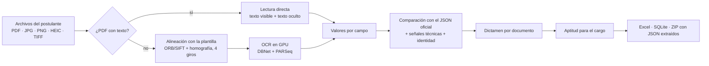

# Verificación documental de postulantes

Sistema que verifica si los documentos que entrega un postulante a un puesto de operador de equipos son
**auténticos, están vigentes y lo habilitan para el cargo**.

Trabaja con dos documentos:

- la **Hoja de Vida** del Registro Civil (2 páginas);
- el **Certificado de Competencia**, en sus diferentes versiones.

Cada documento se compara, campo por campo, con su dato oficial obtenido de la fuente (JSON).

El postulante puede entregar un PDF original, un escaneo, una foto de celular, una captura de pantalla o una imagen
reenviada por WhatsApp. El sistema identifica el documento, lo alinea con su plantilla, lo lee (directo si es un PDF
con texto, con OCR si es imagen) y emite un dictamen con sus motivos.



## Dictámenes

| Dictamen | Significado |
|---|---|
| **AUTÉNTICO** | Todo coincide con el dato oficial. |
| **FALSIFICADO** | Un dato no coincide o hay evidencia técnica de alteración (texto oculto, objetos superpuestos, timbre electrónico que no coincide con lo impreso, documento a nombre de otro RUT...). |
| **NO VÁLIDO** | Versión "COPIA, no válida como certificado". |
| **OBSERVADO** | Lectura dudosa o indicios que requieren revisión humana. |
| **DESACTUALIZADO** | Genuino, pero emitido hace demasiado tiempo o con datos que cambiaron después. |
| **NO LEGIBLE** | No se pudo leer. El sistema no acusa lo que no puede leer. |
| **NO RECONOCIDO** | El archivo no es ninguno de los documentos solicitados. |
| **SIN DATO OFICIAL** | No se entregó el JSON oficial: solo se extraen los datos. |

La aptitud para el cargo (**APTO / NO APTO / INCOMPLETO / NO EVALUABLE**) se decide con los datos oficiales y con
los requisitos de [config/requisitos_cl.yaml](config/requisitos_cl.yaml): clases de licencia, control vigente,
antecedentes y certificado AMECO aprobado y vigente para el equipo del cargo.

### Principio de las reglas con OCR

Quien falsifica reemplaza un valor por **otro valor válido**: otro nombre, un RUT con dígito verificador correcto,
APROBADO en vez de REPROBADO.

Un error de lectura, en cambio, produce algo **inválido o casi igual**. Por eso, en documentos leídos por OCR:

- una diferencia solo se acusa cuando el valor leído es válido y se leyó con confianza alta;
- lo demás queda en **OBSERVADO**, para revisión humana.

## Reconocedor OCR: entender, no memorizar

El reconocedor (PARSeq) se reentrenó para que lea letra por letra en vez de recordar nombres:

- un vocabulario de 4 000 nombres y 12 000 apellidos de unos 25 orígenes;
- un 20 % de esas palabras reservado solo para la prueba;
- texto aleatorio sin sentido;
- degradaciones de foto, escaneo y WhatsApp.

| Prueba | Modelo anterior | Modelo nuevo |
|---|---|---|
| Nombres nunca vistos | 76,6 % | **99,5 %** |
| Texto aleatorio | 62,5 % | **96,2 %** |
| Fotos en malas condiciones | 60,8 % | **95,0 %** |
| Palabras con tilde o Ñ | 77,6 % | **97,1 %** |
| PDFs reales, palabras (150 DPI) | 99,45 % | **99,82 %** |

Método, datos y resultados completos en [entrenamiento/FICHA_RECONOCEDOR.md](entrenamiento/FICHA_RECONOCEDOR.md).

## Estructura

```
verificacion/            núcleo: lectura, alineación, OCR, comparación, reportes, protección de recursos
  chile/                 flujo de los documentos chilenos (plantillas, lectura, reglas, aptitud, extracción)
entrenamiento/           entrenamiento y evaluación del reconocedor y del detector, calibración de la confianza
auditoria/               medición del flujo contra un ground truth (solo lectura: nunca alimenta reglas ni modelos)
visor/                   visor web local para revisar postulantes en lote
visor_pruebas/           visor para un evaluador externo: procesa en memoria, acceso por IP + contraseña
scripts/sinteticos_reales/vocabulario_amplio.py   vocabulario de nombres para el reentrenamiento
config/requisitos_cl.yaml                          requisitos por cargo
tests/                   pruebas automáticas
verificar_postulante_cl.ipynb                      verificación de un postulante paso a paso
```

## Instalación

Requiere Python 3.12 (o superior) y, para el OCR en GPU, una tarjeta NVIDIA. Sin GPU funciona en CPU, más lento.

```bash
pip install -r requirements.txt
```

**Lo que no está en el repositorio:**

- **Plantillas oficiales** (`official_file/`): PDF en blanco de la Hoja de Vida y de los certificados AMECO, que el
  sistema usa para ubicar cada campo. Hay que agregarlas con los nombres que espera
  [verificacion/chile/plantillas_cl.py](verificacion/chile/plantillas_cl.py).
- **Pesos del modelo** (`modelos/`): no se publican. [verificacion/config.py](verificacion/config.py) indica qué
  archivo usa; sin él, el lector usa el PARSeq preentrenado de docTR.
- **Datos:** documentos de postulantes, datos oficiales y conjuntos de entrenamiento. Contienen datos personales o se
  generan localmente.
- **Generador de documentos sintéticos:** rellena las plantillas oficiales con timbre, firmas y códigos para
  entrenar y medir. No se publica porque permitiría fabricar documentos falsos.

## Uso

**Verificar todos los postulantes de una carpeta:**

```bash
python -u -m verificacion.chile.pipeline_cl --postulantes postulant_files --oficiales webscrap_files --salida resultados/chile
```

Cada postulante es una carpeta con sus documentos en `postulant_files/<NOMBRE>/` y sus JSON oficiales en
`webscrap_files/<NOMBRE>/`. El reporte queda en `resultados/chile/reporte_verificacion.xlsx`.

**Visor local** (revisión en lote, con caché y Excel acumulado):

```bash
python -m visor.servidor
```

**Visor de pruebas para un evaluador externo:** los archivos se procesan en memoria y no se guardan en disco. El
acceso se limita a las IP registradas (por ejemplo, la de la PC del evaluador en una red privada como Tailscale) y
requiere contraseña; tras 5 intentos fallidos la IP se bloquea 15 minutos.

```bash
python -m visor_pruebas.configurar --clave                 # contraseña (se guarda solo su hash)
python -m visor_pruebas.configurar --ip 100.101.102.103    # IP permitida
python -m visor_pruebas.configurar --host 100.64.0.5       # dirección donde escucha el visor
python -m visor_pruebas.servidor
```

## Pruebas

```bash
python -m pytest tests
```

Las pruebas que necesitan las plantillas oficiales o los documentos de demostración se omiten si esos archivos no
están.

## Convivencia con otros procesos

Antes de lanzar un trabajo pesado (pipeline, entrenamiento, calibración), el sistema:

- observa la GPU y la memoria durante una ventana de tiempo, para captar los picos de otros programas;
- usa un candado para que no corran dos ejecuciones a la vez;
- limita su propia VRAM.

Durante la ejecución, un vigía revisa la memoria del sistema. Si baja de un umbral, el entrenamiento guarda su avance,
libera memoria y espera a que se recupere. Nunca toca procesos ajenos.

## Licencia

[MIT](LICENSE) © 2026 Luis Quispe
